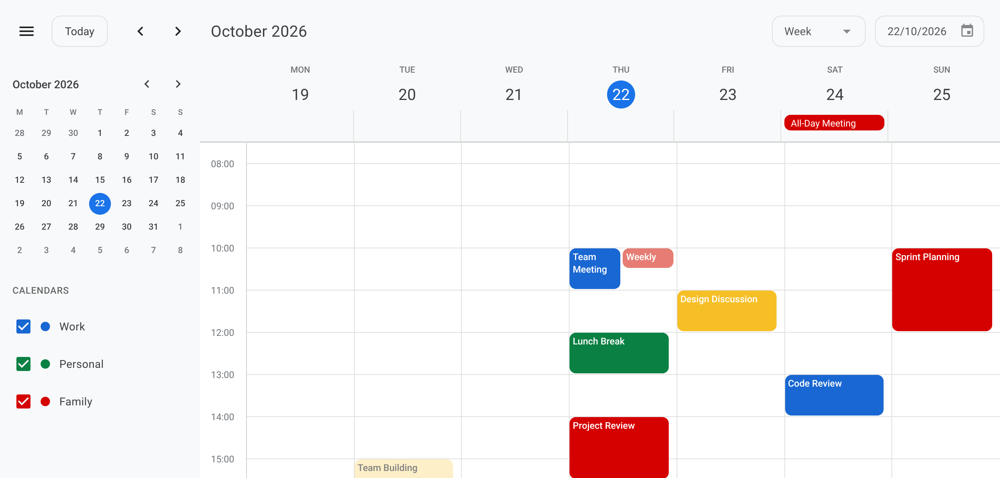
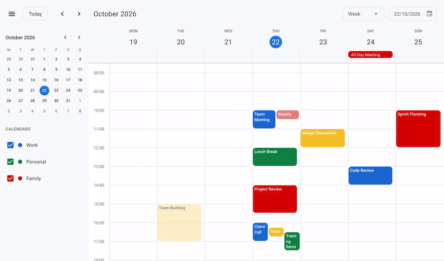
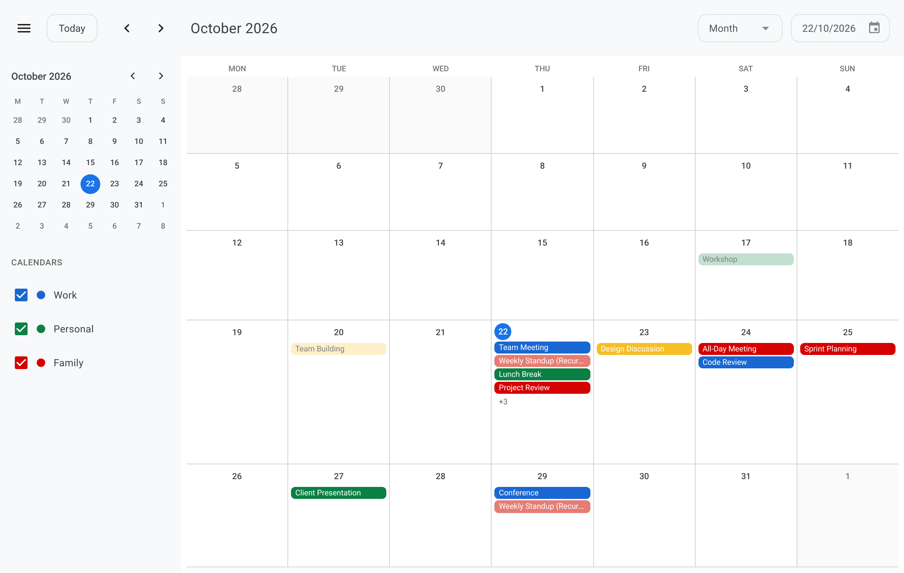
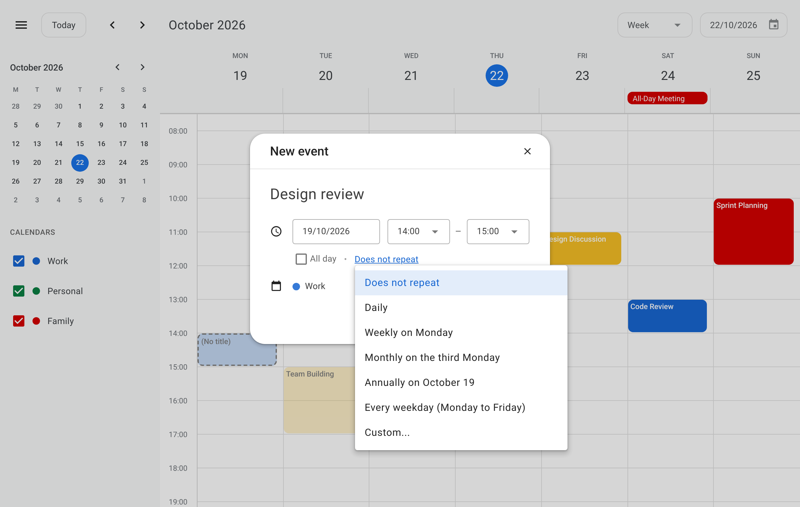
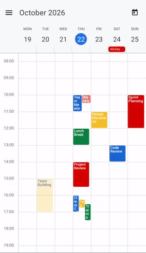
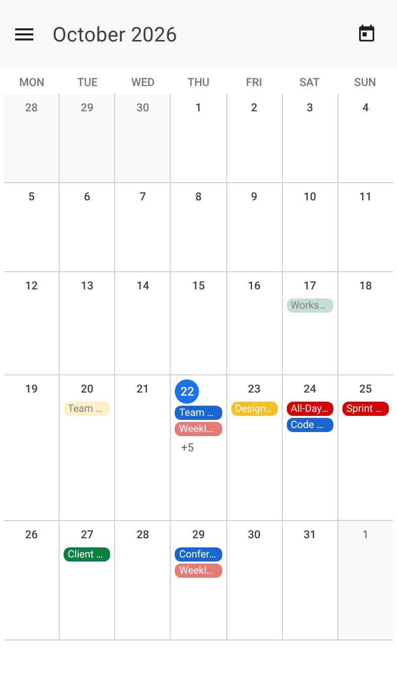
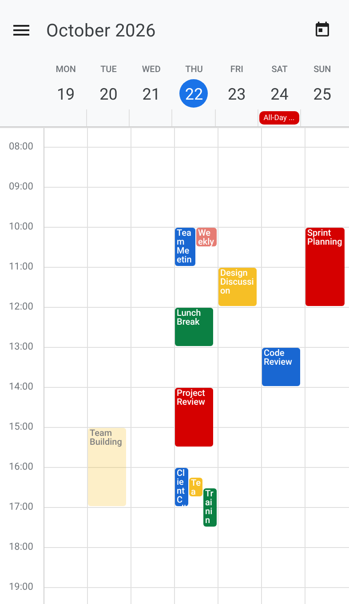
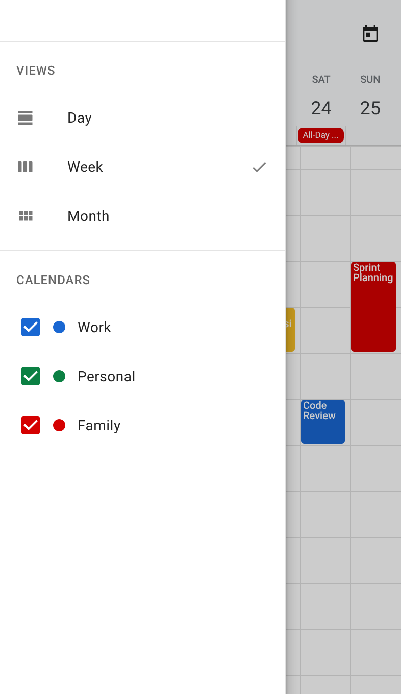

# vue-calendarium

[](https://www.npmjs.com/package/vue-calendarium)
[](./LICENSE)
[](https://vuejs.org/)
[](https://vuetifyjs.com/)
[](https://zehenrique.github.io/vue-calendarium/)

A full-featured scheduling and calendar component for **Vue 3** and **Vuetify 4**. Supports Month, Week, and Day views, recurring events (RRULE), drag-and-drop, mobile gestures, theming via CSS variables, and Temporal-based date handling.

**[▶ Try the live demo](https://zehenrique.github.io/vue-calendarium/)**. Open it on your phone to try the swipe and pinch gestures, or on a desktop switch your browser to a phone-sized viewport with its device mode (Chrome and Edge: press F12, then Ctrl+Shift+M; hold Shift and drag to pinch). Read the [documentation](https://zehenrique.github.io/vue-calendarium/docs.html) online.

<p align="center">
  <a href="https://zehenrique.github.io/vue-calendarium/"></a>
</p>

Upgrading from version 1? Follow the [upgrade guide](./docs/UPGRADING.md).

---

## Features

- **Month, week and day views**, with a desktop sidebar and a current-time line
- **Built-in dialogs** to create, view, edit and delete events, or your own dialogs with a live preview
- **Recurring events** (RRULE) with a repeat editor and "this / following / all events" changes
- **Calendars** with colours and show/hide, **drag and drop**, and **iCalendar** import and export
- **Mobile layout** with swipe between periods, pinch-to-zoom, a side menu and bottom sheets
- **Theming** with CSS variables and presets, **English and Portuguese**, 24-hour times and the **Temporal API**

---

## See it in action

<p align="center">
  
  
</p>

<p align="center">
  
  
</p>

On a phone, the calendar swipes between periods, pinches to zoom the time grid and moves its views and calendars into a side menu:

<p align="center">
  
  
  
  
</p>

---

## Why vue-calendarium?

Most free Vue calendars either leave mobile interaction and event forms for you to build, or sell them as paid add-ons. vue-calendarium includes them:

| | vue-calendarium | Typical free alternatives |
| --- | --- | --- |
| Recurring events | RRULE plus a recurrence editor UI | Not included, a plugin without an editor, or paid |
| Create and edit forms | Built in (or bring your own) | Usually build your own, or paid |
| Swipe between periods, pinch-to-zoom | Built in | Not included |
| Phone layout (drawer, bottom sheets) | Built in | Responsive layout only |
| Vuetify / Material Design | Native Vuetify components | Separate design system |

---

## Requirements

| Peer dependency | Version |
| --- | --- |
| Vue | `^3.5` |
| Vuetify | `^4.0` (your app must be wrapped in `<v-app>`) |
| vue-i18n | `^11.0` |

If you are coming from Vuetify 3, check your breakpoints and global CSS resets; see the [upgrade guide](./docs/UPGRADING.md) and [Theming](./docs/THEMING.md#vuetify-4).

---

## Installation

```bash
npm install vue-calendarium
```

Import Vuetify's styles and the Material Design Icons font (installed with the package) once in your app:

```js
import 'vuetify/styles';
import '@mdi/font/css/materialdesignicons.css';
```

The package includes its own styles and TypeScript types, and loads the touch gesture library on demand, so it also works with server-side rendering (add `import 'vue-calendarium/style.css'` there). See the [API reference](./docs/API.md#styles).

---

## Quick Start

A complete, copy-paste setup. It is also a runnable project in [`examples/minimal`](./examples/minimal), which you can [open on StackBlitz](https://stackblitz.com/github/zehenrique/vue-calendarium/tree/main/examples/minimal).

### 1. Set up Vuetify and vue-i18n

`src/main.js`:

```js
import { createApp } from 'vue';
import { createI18n } from 'vue-i18n';
import { createVuetify } from 'vuetify';
import * as components from 'vuetify/components';
import * as directives from 'vuetify/directives';
import 'vuetify/styles';
import '@mdi/font/css/materialdesignicons.css';
import { translations } from 'vue-calendarium';
import App from './App.vue';

const i18n = createI18n({
  legacy: false,
  locale: 'en',
  fallbackLocale: 'en',
  messages: { en: translations.en, pt: translations.pt }
});

const vuetify = createVuetify({ components, directives });

createApp(App).use(vuetify).use(i18n).mount('#app');
```

### 2. Render the calendar

`src/App.vue`:

```vue
<template>
  <v-app>
    <v-main style="height: 100vh">
      <Calendar :calendar-app="calendarApp" />
    </v-main>
  </v-app>
</template>

<script setup>
import { Temporal } from '@js-temporal/polyfill';
import { Calendar, createCalendar, createViewDay, createViewWeek, createViewMonth } from 'vue-calendarium';

const today = Temporal.Now.plainDateISO().toString();

const calendarApp = createCalendar({
  views: [createViewDay(), createViewWeek(), createViewMonth()],
  defaultView: 'week',
  locale: 'en-US',
  calendars: [
    { id: 'work', name: 'Work', color: '#1967D2' },
    { id: 'personal', name: 'Personal', color: '#0B8043' }
  ],
  events: [
    { title: 'Team meeting', start: `${today}T10:00:00`, end: `${today}T10:30:00`, calendarId: 'work', color: '#1967D2' },
    { title: 'Lunch with Sam', start: `${today}T12:30:00`, end: `${today}T13:30:00`, calendarId: 'personal', color: '#0B8043' },
    { title: 'Weekly standup', start: `${today}T09:00:00`, end: `${today}T09:30:00`, calendarId: 'work', color: '#1967D2', rrule: 'FREQ=WEEKLY;COUNT=8' }
  ]
});
</script>
```

The calendar fills its parent, so the parent needs a height (`100vh` above). `@js-temporal/polyfill` is installed with the calendar. Add more events later with `calendarApp.eventsService.add({ ... })`.

---

## Next steps

- Load and save events with the services and callbacks: [Events and dialogs](./docs/EVENTS.md)
- Repeating events: [Recurring events](./docs/RECURRING_EVENTS.md)
- Use your own dialogs: [Using your own dialogs](./docs/EVENTS.md#using-your-own-dialogs)
- Colours and fonts: [Theming](./docs/THEMING.md)
- Every option and method: [API reference](./docs/API.md)

---

## Documentation

All guides are also on the [documentation website](https://zehenrique.github.io/vue-calendarium/docs.html).

| Guide | What it covers |
| --- | --- |
| [Upgrading](./docs/UPGRADING.md) | Moving from 1.x to 2.0 |
| [Views](./docs/VIEWS.md) | Month, week and day views, navigation and the sidebar |
| [Events and dialogs](./docs/EVENTS.md) | Creating and editing events, calendars, callbacks, your own dialogs, iCalendar files |
| [Recurring events](./docs/RECURRING_EVENTS.md) | Repeat rules and changing one occurrence or many |
| [Drag and drop](./docs/DRAG_AND_DROP.md) | Moving events by dragging them |
| [Mobile and touch gestures](./docs/MOBILE.md) | The phone layout, swipe, pinch-to-zoom and the side menu |
| [Theming](./docs/THEMING.md) | Colours, fonts and presets |
| [Languages and formats](./docs/I18N.md) | Languages, dates and times |
| [Accessibility](./docs/ACCESSIBILITY.md) | Keyboard and screen reader support |
| [Troubleshooting](./docs/TROUBLESHOOTING.md) | Fixes for common problems |
| [API reference](./docs/API.md) | Every export, option, callback and method |
| [Theme variables](./docs/THEME_REFERENCE.md) | Every CSS variable and its default |
| [Changelog](./CHANGELOG.md) | Changes in each version |

---

## Development

```bash
make dev        # start the dev server
make test       # unit tests (Vitest)
make test-ui    # end-to-end tests (Playwright)
make media      # redo the README screenshots and GIFs in assets/ (run `make dev` first; needs ffmpeg)
```

`npm run build:lib` builds the npm package into `lib/` (it also runs automatically before `npm publish`). The type definitions in [`types/index.d.ts`](./types/index.d.ts) are written by hand: update them whenever the public API changes.

The [website](https://zehenrique.github.io/vue-calendarium/) has the demo (`index.html` + `src/App.vue`) and the documentation (`docs.html` + `site/`), which renders the Markdown files at build time. To place a new page in its sidebar, add it to `SECTIONS` in `site/docs-page.js`. Both are built with `make build` and deployed to GitHub Pages by [`.github/workflows/pages.yml`](./.github/workflows/pages.yml).

---

## Contributing

Contributions are welcome. Please read the [contributing guide](./CONTRIBUTING.md) and the [code of conduct](./CODE_OF_CONDUCT.md) before opening an issue or pull request.

---

## License

[MIT](./LICENSE) © zehenrique
